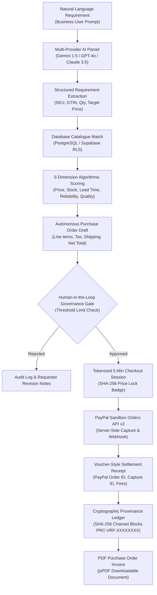

# ProcureAI — Autonomous AI Procurement & Payment Agent

> **Intelligent Procurement. Trusted Suppliers. Seamless Payments powered by PayPal.**

[](https://procureai-zeta.vercel.app)
[](https://developer.paypal.com)
[](https://supabase.com)
[-45ba4b?style=for-the-badge&logo=playwright&logoColor=white)](https://procureai-zeta.vercel.app)

**ProcureAI** is an enterprise-grade autonomous B2B procurement and FinTech SaaS platform engineered for the **PayPal AI Hackathon 2026**. It transforms manual corporate purchasing into an intelligent, transparent, and human-controlled autonomous workflow powered by multi-provider AI agents, transparent supplier intelligence, demand forecasting, automated purchase order generation, human-in-the-loop authorization gating, and tokenized PayPal Orders API v2 settlement.

---

## 🌐 Live Production Application

- **Live Production URL:** **[https://procureai-zeta.vercel.app](https://procureai-zeta.vercel.app)**
- **GitHub Repository:** **[https://github.com/santhoshaiworks03-tech/ProcureAI](https://github.com/santhoshaiworks03-tech/ProcureAI)**
- **Vercel Inspection:** [https://vercel.com/santhoshaiworks03-4358/procureai](https://vercel.com/santhoshaiworks03-4358/procureai)

---

## 🏛️ Autonomous Procurement Lifecycle Architecture



---

## 🌟 Core Modules & Capabilities

### 1. Autonomous AI Procurement Terminal (`/agent`)
- Natural language purchasing requirements (e.g. *"I need 50 Ergonomic Task Chairs, 25 Standing Desks, and 10 Filing Cabinets under ₹5,00,000"*).
- Extracts products, quantities, specifications, and budget into validated JSON schemas.
- Matches requirements strictly against real database catalogue records (no fabricated inventory).

### 2. Multi-Criteria Supplier Scoring Engine (`/intelligence`)
- Algorithmic evaluation model:
  $$\text{Score} = w_{\text{price}} S_{\text{price}} + w_{\text{avail}} S_{\text{avail}} + w_{\text{lead}} S_{\text{lead}} + w_{\text{rel}} S_{\text{rel}} + w_{\text{qual}} S_{\text{qual}}$$
- Default weights: Price (30%), Availability (20%), Delivery (20%), SLA Reliability (20%), Quality/ESG (10%).
- Interactive parameter sliders allowing procurement managers to tune weights with live mathematical recalculation.

### 3. Product Catalogue & AG Grid Community View (`/catalogue`)
- Dual-mode view: **Visual Cards** and **AG Grid Community Enterprise Table**.
- Sort, filter, search by SKU, GTIN, brand, benchmark price, and contracted vendor pricing.
- Multi-supplier price comparison modal with instant procurement routing.

### 4. Human-in-the-Loop Governance Queue (`/approvals`)
- **Strict Human Approval Gate**: The AI agent creates draft purchase orders but cannot execute payments autonomously.
- Spending limits and threshold checks (e.g., ₹2,50,000 corporate threshold).
- Formal review and remark logs with audit history.

### 5. Time-Locked PayPal Checkout Gateway (`/payments`)
- Tokenized checkout sessions with **5-minute countdown timer (`04:59`)**.
- SHA-256 cryptographic price integrity lock preventing client-side tampering.
- Integration with PayPal Orders API v2 (`CAPTURE` intent) with verified webhook dispatcher.

### 6. Cryptographic Provenance Ledger (`/provenance`)
- Append-only blockchain-inspired audit log.
- Sequential block numbers (`#0001`, `#0002`...) with SHA-256 hash chaining:
  $$\text{Hash}_n = \text{SHA256}(\text{Block}_n + \text{Hash}_{n-1})$$
- Generates tamper-evident verification reference codes (`PRC-VRF-XXXXXXXXXXXX`).
- Full JSON block payload inspector modal.

### 7. Predictive Demand & Inventory Forecasting (`/forecasting`)
- Daily consumption velocity analysis and burn rate calculations per SKU.
- Projected stockout horizon dates and automated reorder suggestions.
- Interactive Recharts inventory depth comparison.

---

## 🎨 Unslop Design System Craft

ProcureAI adheres to the [`unslop`](https://heydamir.design/unslop) design methodology (CC-BY-4.0 by [@heydamir](https://x.com/heydamir)), eliminating generic AI template slop in favor of calm, exact enterprise fintech craft:
- **Quiet Chrome**: 240px slate/ink sidebar (`#07090E` - `#334155`), calm surface ground (`#F6F8FA`), hairline neutral borders (`border-slate-200/80`).
- **One Clear Accent**: Single cobalt accent (`#1D4ED8`) reserved strictly for primary actions.
- **Rich Content Moments**: Tabular financial requirement matrix, voucher-style PayPal receipt, and cryptographic block ledger.
- **Typography & Numbers**: Sentence case everywhere (no uppercase tracked labels) and tabular figures (`tabular-nums font-mono`).
- **No Decoration Slop**: Zero gradient text, glowing borders, or looped pulse animations (`animate-pulse`).

---

## 🛠️ Technology Stack

| Layer | Technologies |
|---|---|
| **Frontend** | React 18, TypeScript, Vite, Tailwind CSS, Lucide Icons, React Router DOM, TanStack Query |
| **Enterprise Tables** | AG Grid Community 32 (`ag-grid-community`, `ag-grid-react`) |
| **Data Visuals** | Recharts (Spend trends, inventory horizons), jsPDF (Invoicing) |
| **Payments** | PayPal Developer Platform, PayPal Orders API v2, `@paypal/react-paypal-js`, Express capture companion |
| **Database & Auth** | Supabase, PostgreSQL (28 Relational Tables), Row Level Security (RLS) |
| **AI Architecture** | Multi-Provider Engine (Google Gemini 1.5 Pro, OpenAI GPT-4o, Anthropic Claude 3.5 Sonnet) |
| **Testing** | Playwright Headless Browser Test Suite (21 automated assertions) |
| **Deployment** | Vercel (Production Edge Network) with SPA rewrites (`vercel.json`) |

---

## 🚀 Quickstart & Local Setup

### 1. Clone & Install
```bash
git clone https://github.com/santhoshaiworks03-tech/ProcureAI.git
cd ProcureAI
npm install
```

### 2. Configure Environment Variables
Create `.env` based on `.env.example`:
```ini
VITE_SUPABASE_URL=https://gzjdjrawaenqbmxvxioo.supabase.co
VITE_SUPABASE_ANON_KEY=sb_publishable_gdpo0fVVEuPaMOy-kAq0JA_lYI_RH_4
VITE_PAYPAL_CLIENT_ID=test
```

### 3. Run Development Server
```bash
npm run dev
```
Open **`http://localhost:5173`** in your browser.

### 4. Run Automated Playwright Test Suite
```bash
npm run test:e2e
```

---

## 🔒 Security Architecture

1. **Zero Client-Side Price Trust**: Payable amounts are strictly bound to authorized purchase orders verified server-side.
2. **5-Minute Session Expiry**: Prevents stale price exploitation and market volatility risks.
3. **Payment Idempotency**: Unique transaction keys prevent double capture on flaky connections.
4. **Append-Only Cryptographic Ledger**: Ensures complete compliance, auditability, and tamper detection.

---

## 📄 License
MIT License. Developed for the **PayPal AI Hackathon 2026**.
