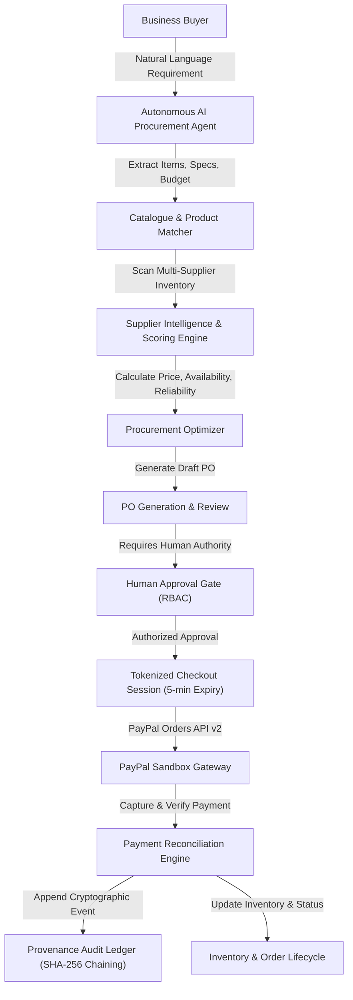

# ProcureAI: Architectural Specification & System Blueprint

## 1. System Overview
**ProcureAI** is an autonomous enterprise B2B procurement and FinTech platform. It bridges natural-language purchasing requests with intelligent catalog matching, multi-criteria supplier scoring, automated purchase order generation, human-in-the-loop approval gating, tokenized PayPal checkout, and append-only provenance auditing.

## 2. Core Pillars

### 2.1 AI Independence & Multi-Provider Architecture
- Pluggable provider interface supporting **Google Gemini**, **OpenAI**, and **Anthropic Claude**.
- Configurable via `AI_PROVIDER` and environment variables.
- Structured JSON outputs strictly mapped to Zod schemas.
- Rule-based procurement optimization fallback guaranteeing high availability even under network or quota restrictions.

### 2.2 Payment Security & Tokenized Checkout
- Strict compliance with PayPal Orders API v2.
- Server-side amount computation prevents frontend tampering.
- Tokenized checkout sessions expire strictly after 5 minutes with SHA-256 integrity verification.
- Idempotent payment capture prevents double-charging.
- Zero storage of raw credit card or banking credentials.

### 2.3 Strict Human-in-the-Loop Governance
- The AI Agent generates quotations and purchase order drafts but is **strictly blocked** from authorizing financial transactions.
- Role-based spending limits determine required authorization tiers.

### 2.4 Cryptographic Provenance Ledger
- Append-only audit trail.
- Every state change (PO creation, approval, payment capture, shipment) computes a SHA-256 hash chained to the prior block.
- Generates verifiable reference codes (e.g., `PRC-VRF-8F2B1C90D4A1`).
